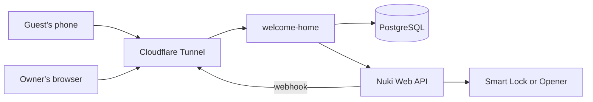

# welcome-home

A private web app where several owners connect their Nuki account and create unique, date-bound links that open the door without an app or codes. A guest opens the link on their phone and slides to open.



## Where to read next

| You want to | Read |
|---|---|
| Use it: connect Nuki, create links, help a guest | [User guide](docs/user-guide.md) |
| Know what each feature does and how | [Features](docs/features.md) |
| Maintain it: requirements, architecture, decisions, tests | [AGENTS.md](AGENTS.md) |
| Know how data and secrets are protected | [Security and data](docs/security.md) |
| Set it up: the image, the stack, its secrets, backups | [Deployment](docs/deployment.md) |
| Run it: first start, upgrades, restoring, when something fails | [Runbook](docs/runbook.md) |

## Development

- JDK 25
- Docker (Postgres for development and Testcontainers for tests)

```sh
./gradlew build          # compile, run the tests (Postgres with Testcontainers) and check javadoc
./gradlew generateKeysets  # once: development keysets in secrets/ (git-ignored)
docker compose up -d     # development Postgres on localhost:5432
./gradlew bootRun        # start the app with the dev profile on http://localhost:8080
```

Quick check: `curl http://localhost:8080/actuator/health`.

The compiler runs [Error Prone](https://errorprone.info) with [NullAway](https://github.com/uber/NullAway) in JSpecify mode: in the app's code nothing is null unless it is `@Nullable` (`org.jspecify.annotations`), and the build fails where a possibly null value could be dereferenced or passed where it may not. Every package is `@NullMarked` in its `package-info.java`, so the IDE knows it too. Tests are not checked for nullness.
