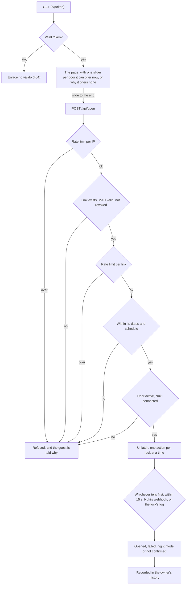

# Features

What welcome-home does and how, feature by feature. For how to use it, see the [user guide](user-guide.md); for why it is built this way, [AGENTS.md](../AGENTS.md); for its settings on a server, [deployment](deployment.md).

## Pages

Signed-in owners have a menu at the top of every page:

- **Home** (`/`, the "welcome-home" name): the owner's locks, each with what is wrong with it, a button to create a link, its links and its history, and their latest 10 guest attempts across all locks (`audit.RecentAttempts`), each in its lock's time zone and leading to that lock's or link's history. It also asks the owner to verify their email, to connect Nuki, or to connect it again when Nuki rejected the connection.
- **Cerraduras** (`/locks`): syncing with Nuki, each lock's settings and state, its links and its history.
- **Configuración** (`/settings`, which leads to its first section): one page per section, linked to each other by a row under the menu: Nuki (`/settings/nuki`), Preferencias (`/settings/preferences`: language and color theme), Avisos (`/settings/notifications`), Passkeys (`/settings/passkeys`) and Cuenta (`/settings/account`: the owner's email, and closing their account). Their former addresses (`/nuki/connection`, `/notifications`, `/passkeys`, which emails sent before the move link to, and `/settings/language`) redirect there permanently.
- **Administración** (`/admin/owners`): admins only.

The menu marks the section a page belongs to (`aria-current="page"`): each page passes it to the `menu` fragment of `fragments/layout.html`, and configuration's pages also pass theirs to the `settings` fragment.

## Color theme

Pages follow the system's light or dark theme, as Pico CSS does by itself. In Configuración → Preferencias an owner may choose light or dark instead (`PUT /settings/theme`): the choice is kept in this browser only, in the `theme` cookie (`light` or `dark`, one year, `HttpOnly`, `SameSite=Lax`, `Secure` like the session cookie), and every page, guest pages included, puts it in `<html data-theme>`. As the server writes the attribute, there is no flash of the other theme and no script. Choosing "Automático" deletes the cookie. It is a functional cookie, set only at the owner's request, so it needs no consent banner.

## Owners and passkeys

Owners register only through single-use invitations, valid for 72 hours. The first admin's invitation comes from a one-off command that prints the link and exits, without starting the web server; it refuses when an admin already exists:

```sh
./gradlew bootRun --args='--bootstrap-admin'          # development
docker compose run --rm app --bootstrap-admin         # production
```

Opening an invitation link asks for an email and a name for the passkey, and creates the passkey on that device; owners then sign in with it at `/login`. There are no passwords. Registering and signing in require the passkey to verify its user, with a PIN, fingerprint or face: a security key without a PIN is refused.

A new owner then gets an email with a link to verify that the address is theirs (valid 7 days; the home page offers to send another, at most every 5 minutes). Opening the link shows a button, and only pressing it verifies the address, as mail scanners open links and one at a mistyped address must not verify it. Until then no other email goes to the address, and the home page and the notifications page say so. The link's token is kept only as a SHA-256, with its expiry, on the owner's row. Owners registered before this existed count as verified.

Admins invite further owners from the admin panel (`/admin/owners`, linked from the owner's panel): each invitation has a note on who it is for and may make the new owner an admin too. Its link is shown only once, since only a hash of the token is stored. The panel lists owners' emails and registration dates, never their locks or links: Row-Level Security applies to admins like to any other owner.

`/admin/owners`, below the owners, also lists the invitations and passkey recovery links that could still be used, whoever created them, without their URLs, which are not stored. "Anular" (`DELETE /admin/invitations/{id}`, after confirming) makes one stop working at once.

"Dar de baja" (`DELETE /admin/owners`, after confirming) deletes an owner with everything of theirs, in one transaction: the owner row's foreign keys cascade to their passkeys, Nuki connection, locks, links, history and recovery links. Invitations they created stay, without a creator. Their open sessions end at once. An admin cannot delete themselves, so an admin is always left. The deleted data stays in the backups until they expire (30 days); the owner's Nuki API token, if they pasted one, should also be deleted in Nuki Web.

Each owner manages their passkeys at `/settings/passkeys` (Configuración → Passkeys): the list shows each one's name, when it was created and when it last signed in. An owner renames them (`PATCH /settings/passkeys/{credentialId}`), deletes the one of a lost device (`DELETE /settings/passkeys/{credentialId}`, after confirming; never the last one, so that nobody locks themselves out) and adds another from the device or password manager where they want it, with a name, through Spring Security's own `POST /webauthn/register/options` and `POST /webauthn/register`. Passkeys live in Spring Security's tables, tied to their owner by `user_entities.owner_id`, by which every query joins, and another owner's passkey is a 404. Deleting one ends the owner's sessions on other devices.

Each owner's account is at `/settings/account` (Configuración → Cuenta). Changing the email there (`PUT /settings/account/email`) takes effect at once, in `owner.email` and in the passkey store's `user_entities.name`, and leaves it unverified: the new address gets the verification link a new owner gets, no other email goes there until it is opened, and the previous address, if it was verified, is told. The owner's other sessions end, as they still know them by the previous email, and this one goes on under the new one. An email that another owner has is refused. Passkeys on the owner's devices keep showing the previous email, and still sign in. "Darme de baja" (`DELETE /settings/account`, after confirming) deletes the owner's account as the admin panel's "Dar de baja" does, and signs them out to `/login?deleted`. The only admin cannot, so that an admin is always left.

Each owner's activity is at `/settings/activity` (Configuración → Actividad): their latest 100 sign-ins and changes to links, newest first, with where each came from, so that they can tell whether someone else has been in their account. A sign-in names the passkey it used, the one whose last use it has just set; a link's change says what it was (created, edited, a new URL, disabled, deleted), and which link of which lock while the link exists, as the entry does not copy its label, which usually holds a guest's name. Where it came from is the country's flag and the IP address, as in the history, from the same headers (`welcomehome.access.client-ip-header` and `client-country-header`, read by `config.ClientIp` and `ClientCountry`). Times are in the server's time zone, as entries span locks. `auth` publishes an `OwnerSignedIn` from the WebAuthn filter's success handler (`SignInAnnouncer`), and `links` a `LinkChanged` in the transaction of every change; `audit`'s `OwnerActivityRecorder` records them on the request's thread, which it reads where the request came from, the link's change in the same transaction, so that there is no change without its entry. Entries are kept in `owner_activity`, under Row-Level Security, with their lock and link ids and no foreign keys, as an entry outlives a deleted link; the history's purge deletes them after `welcomehome.audit.retention` and forgets their IP address after `ip-retention`, as for attempts.

An owner who lost their passkey gets a passkey recovery link: from the admin panel ("Nueva passkey", next to each owner), or from the server for an admin who cannot sign in at all:

```sh
docker compose run --rm app --recover-owner=ana@example.com
```

It is an invitation that names its owner: single use, valid for 72 hours, shown once. Opening it asks for a name for the passkey and creates it on that device for that owner, who keeps the passkeys they had, and signs them in. The names are what tell the new passkey from the lost one at `/settings/passkeys`; a page loaded before names were asked for registers its passkey as "Passkey". Whoever has the link signs in as that owner, so an admin who creates one can; the link records which admin created it, and the owner is emailed when it is created and when a passkey is added with it (see Notifications). Invitations and recovery links, used or not, are deleted 30 days after they expire, by a daily job (`welcomehome.admin.purge-cron`, `0 35 3 * * *`, in the server's time zone).

## Nuki

The `nuki` module is the only one that talks to Nuki, through the Nuki Web API ([definition](https://api.nuki.io/static/swagger/swagger.json)) with each owner's access token: an OAuth2 access token, or an API token the owner pasted. Other modules use the `LockProvider` interface, which takes an owner id: the module finds and decrypts that owner's token itself, so tokens never leave it in clear.

Owners connect at `/settings/nuki`, where "Conectar con Nuki" is the way offered first:

1. `GET /settings/nuki/oauth` keeps a random `state` and a random PKCE code verifier in the owner's session and sends them to Nuki's `GET /oauth/authorize` with the verifier's challenge (RFC 7636, `S256`), asking for `smartlock.readOnly`, `smartlock.action`, `smartlock.log`, `offline_access` and `webhook.central`. The last one is what Nuki's central webhooks need; a client whose Advanced API has no webhooks may not ask for it, so when Nuki sends the owner back with `invalid_scope`, the app sends them to Nuki once more without it (and logs it), and it is not required of the tokens either. It is a link, not a form: the CSP's `form-action 'self'` would stop a form whose answer leaves the site.
2. The owner signs in to Nuki and accepts; Nuki sends them back to `GET /nuki/callback` with a `code` and the `state`.
3. The callback takes the `state` out of the session, so it works once, and goes on only if it matches and was started by the same owner. It exchanges the code, with the code verifier, at `POST /oauth/token` (the client's id and secret both as HTTP Basic and in the form), so a code that leaked on its way back is useless without the session; checks that every scope it needs (all but `webhook.central`) and a refresh token were granted, and checks the access token as a pasted one is checked (below). Then it stores the access token, the refresh token and when the access token expires, each encrypted for its owner, and goes back to `/settings/nuki`, which names the locks found.

Every way back that fails, the owner saying no at Nuki included, ends on `/settings/nuki` with a message and nothing changed. Before a call, an access token that expires within 5 minutes is refreshed (`grant_type=refresh_token`), one refresh at a time per owner: Nuki rotates the refresh token, so the one it returns replaces the stored one. A refresh that Nuki refuses disconnects, as a rejected token does; one it does not answer is not repeated, and fails the call without disconnecting. The daily check (below) refreshes too, so a refresh token, which lasts 90 days, does not expire while the app runs. The scopes Nuki grants are logged, on connecting ("Nuki granted owner ... the scopes ...") and on every refresh, never the tokens. The callback's query is masked in logs, like guests' tokens.

OAuth2 needs welcome-home's client at Nuki, which Nuki grants with its Advanced API (Nuki Web → API): its client id and secret go in `welcomehome.nuki.oauth.client-id` and `welcomehome.nuki.oauth.client-secret`, and its callback URLs must include `BASE_URL` followed by `/nuki/callback`. In production they are Docker secrets (see [deployment](deployment.md)); in development, the files `secrets/config/welcomehome.nuki.oauth.client-id` and `secrets/config/welcomehome.nuki.oauth.client-secret`, which the dev profile reads. Without them, `/settings/nuki` offers only the API token, and the two routes answer 404.

Owners connected with OAuth2 unlatch through Nuki's Advanced API (`POST /smartlock/{id}/action/advanced`), which answers with a request id and, once the lock has run the action, reports its outcome with a webhook to the client's central webhook URL, set in Nuki Web (API → Advanced API) to `BASE_URL` followed by `/nuki/webhook` (see the runbook).

- **Who may send one.** Nuki signs each webhook with the client secret, the HMAC-SHA256 of its body in `X-Nuki-Signature-SHA256` ([how](https://docs.nuki.io/guide/webhooks/monitoring)). `POST /nuki/webhook` refuses one without a valid signature (401), and answers every signed one with 204, as Nuki turns off the webhooks of a client whose webhooks fail too often.
- **What it uses.** Only reports of actions, matched by their request id, kept in memory for two minutes as one may arrive before Nuki's answer to the request. Nuki's test webhook and the webhooks about devices are ignored, so none of the device events needs to be ticked in Nuki Web. The webhook URL is the client's, so the development app's reports also go to production's, which ignores them.
- **When Nuki refuses.** If Nuki refuses the advanced request (a 4xx other than 429), it ran nothing, and the plain `POST /smartlock/{id}/action` is sent instead. The app logs the status and Nuki's reason, its `WWW-Authenticate` challenge and its answer, on one line and cut at 300 characters.
- **An API token** is the owner's own, whose webhooks would go to the owner's own webhook URL, if any: it unlatches with the plain action, whose outcome only the lock's log tells. Without an OAuth2 client, `/nuki/webhook` answers 404 too.

Pasting an API token generated in Nuki Web (Menu → API) is the alternative, folded under "Usar un API token en su lugar"; the page explains how, step by step. The token needs only `smartlock.readOnly`, `smartlock.action` and `smartlock.log`: view the locks, operate them and read their log (in Nuki Web's Spanish form, "Ver dispositivos", "Gestionar dispositivos" and "Ver protocolos de cierre y obtener notificaciones de protocolo"). The token is stored only after `GET /smartlock` and `GET /smartlock/log` accept it, encrypted for its owner, and it is never shown again: openings are confirmed from the lock's log, so a token that may not read it is refused, with a message that names the three permissions. Whether it may operate the locks cannot be checked without acting on one. Pasting a new token, or connecting with Nuki, replaces whatever connection there was and reconnects a disconnected account; the connection keeps its id, so locks keep it.

Either way, welcome-home sees only the devices activated for Nuki Web, one by one, in the Nuki app. For an owner who has just installed theirs, the page has a folded guide, "¿Acabas de instalar tu Nuki?": put the device online (Nuki's remote access: the Smart Lock's built-in Wi-Fi, Thread or a Nuki Bridge, depending on the model; a Bridge for an Opener), activate Nuki Web in the app's device settings, under "Características y configuración", for each device, and connect with that same account, or sync the locks if already connected. Its steps link to Nuki's help center in the owner's language. It unfolds when connecting found no locks, and the locks page, when it has none, links to it (`/settings/nuki#nuki-web`).

When Nuki answers 401 to a stored token, and again when asked once more with a read, the connection becomes `DISCONNECTED`: links stop opening and the owner's home page asks them to connect again. A job checks every connection daily (`welcomehome.nuki.check-cron`, 08:00 server time by default), so that the owner learns about a revoked token before a guest does. Another tries the connections disconnected in the last 7 days every hour (`welcomehome.nuki.recheck-cron`): if Nuki accepts them again, they are connected again and the owner is told. A 403 (a permission missing) or an unanswered call does not disconnect. An unlatch refused with a 403 is recorded as `missing-permission`, so the history and the owner's email say that the Nuki connection may not open, whether it is an API token or OAuth2, while the guest only reads that the door is not available.

Disconnecting (`DELETE /settings/nuki`, the "Desconectar Nuki" button) deletes the tokens and, for OAuth2, asks Nuki to revoke them; if Nuki does not confirm it, that is only logged. Deleting an owner does the same. A pasted API token cannot be revoked this way: the page tells the owner to delete it in Nuki Web. Locks and links stay as they are, without any change of state, but cannot open the door until the owner connects again: guests see "not available".

Calls time out and are retried with exponential backoff: on rate limiting (429, honoring `Retry-After`), and for reads also on server errors and timeouts. The unlatch action is retried only when Nuki cannot have run it (429, or no connection made), so a door never opens twice; after a timeout or a server error Nuki may have run it, so the opening goes on to read the lock's log instead. The defaults, under `welcomehome.nuki.*`:

| Property          | Default               |
|-------------------|-----------------------|
| `base-url`        | `https://api.nuki.io` |
| `connect-timeout` | `PT5S`                |
| `read-timeout`    | `PT10S`               |
| `max-attempts`    | `3`                   |
| `initial-backoff` | `PT0.5S`, doubling    |
| `max-backoff`     | `PT5S`                |
| `oauth.client-id`, `oauth.client-secret` | none: OAuth2 off |
| `revocation-url`  | `https://oauth.nuki.io/oauth2/revoke` |

## Locks

`/locks` lists the owner's locks. Connecting Nuki imports them, and "Actualizar desde Nuki" (`POST /locks/sync`) brings them in line with the Nuki account later. New locks are imported with their Nuki name and time zone, which the owner can change. Nuki reports the time zone as an id from [its list](https://docs.nuki.io/guide/overview/concepts/), with one zone per region (a lock in Madrid reports `Europe/Berlin`, which has the same rules). A new lock gets the server's time zone instead when Nuki reports none, or one that keeps the server's time over the next ten years: with the server in Madrid, a lock in Madrid comes in as `Europe/Madrid`, and so does one in Paris, whose owner can change it. Later syncs keep those choices. Locks no longer in the account become inactive, keeping their links; if they come back, they are active again. Each sync also links the locks to the owner's current Nuki connection. A job does the same every day (`welcomehome.locks.sync-cron`, 08:15 server time by default), except that a list with no locks at all changes nothing, as that is more likely a mistake of Nuki's; only the button acts on one.

The home page and `/locks` also say what is wrong with each lock: no connection with Nuki, a critical battery, a blocked motor, or Auto Lock off (unless the owner relocks some other way; never for an Opener). One request to Nuki reads all of an owner's locks, and those pages wait for it for 2 seconds at most: past that, or if Nuki fails, they say that it could not be checked. Without a working connection they ask Nuki nothing.

Each lock's settings page (`GET /locks/{id}`, saved with `PATCH /locks/{id}`) changes its name, which guests see, its instructions for guests, and its time zone, one of the IANA region zones or UTC, each listed by its id and its name in the owner's language, as zones that share a name (`Europe/Madrid` and `Europe/Berlin` are both "hora de Europa central") must be told apart there. Every other page and email names a lock's zone only by its name in the reader's language (`config.TimeZoneNames`): Java's, except for Spain's, which the bundles name (`time-zone.Europe/Madrid` "hora de España peninsular", `time-zone.Atlantic/Canary` "hora de Canarias"), as Java names Madrid as all of Central Europe. The instructions (`lock.guest_instructions`, up to 1000 characters, blank for none) are what the owner wants every guest of the lock to know, such as the address, the floor or where a key is. Link dates are entered and shown in the lock's time zone but stored in UTC, so changing the time zone changes how existing links are shown, not when they are valid.

The same page keeps where the lock is (`lock.latitude`, `lock.longitude`), against which a guest's distance to the door may be checked when they slide (see the guest page's "Where the guest is", and [docs/design/guest-location-check.md](design/guest-location-check.md)). Importing a lock takes Nuki's position, if the owner set one in the Nuki app (`config.latitude` and `config.longitude`; 0, 0 counts as none), and a sync fills it only where the lock has none, so the owner's stays. The owner types or pastes it as Google Maps copies a place, "40.416775, -3.703790" (decimal points; a comma or spaces between), rounded to six decimals, or presses "Usar mi ubicación actual" at the door, which fills it with the browser's position and says how precise it is (`location.js`); "Ver en el mapa" opens it on OpenStreetMap. A lock without one is offered Nuki's on its page, read live with its state, when Nuki has one: the field shows it, says it is Nuki's and links to it on the map, and saving keeps it, so the owner need not wait for a sync. Left blank, the lock has none, and the next sync takes Nuki's if it gets one; turning the check on without a position is refused, saying how to set one. A form without the field, such as one loaded before it existed, keeps the lock's. Only its owner sees it: it never reaches a guest's page, so that a leaked link does not tell where the door is.

The same page shows the lock's live state from Nuki: position, connectivity, battery and Auto Lock. Without Auto Lock the door stays unlocked after a guest opens it, so the page warns about it, unless the owner ticks that the door is relocked some other way (for example, with home automation). If Nuki cannot be reached, the page still shows the settings.

A Nuki Opener, which opens a building's entrance through its intercom, is imported too, as a lock of type `OPENER` (`lock.device_type`); a Nuki Box, which opens nothing, is not. Its page says what it is and shows its state (ready to open, Ring to Open on, opening), without Auto Lock. A smart lock's page offers the owner's Openers as its "Portal del edificio" (`lock.entrance_lock_id`): its links then open the entrance too, as the guest page describes. Only one of the owner's Openers is accepted, never another owner's lock, a smart lock or the lock itself, and an Opener has no entrance of its own. An Opener may also have links of its own, for an owner with only an Opener.

## Access links

A lock's links page (`GET /locks/{id}/links`) leads with the form that creates links (`POST /locks/{id}/links`): a label, and a start and an end entered in the lock's time zone and stored in UTC. A link's URL is `{BASE_URL}/o/{link_id}.{mac}`, where the MAC covers the link id and its `token_version` (see `LinkTokenSigner`). The database stores no token: the URL is computed again when needed, and incrementing `token_version` invalidates every earlier URL. Inactive locks get no new links.

A link may be limited to certain days and hours: the form's "Limitar a ciertos días y horas", folded unless the link has a schedule, has a row per day with a tick and a range of hours (one per day, `access_link_schedule`). No day ticked means any time within its dates.

- Hours are local to the lock, unlike the dates, so 09:00 stays 09:00 when the clocks change.
- They run from the opening, inclusive, to the closing, exclusive. A closing time not after the opening time is on the next day and belongs to the day it starts on, so 22:00 to 02:00 crosses midnight.
- A second tick, "Todo el día", takes the whole day and hides that row's hours. It is stored as 00:00 to 00:00, which typed by hand means the same, and it ticks the day too, as alone it would leave the link open at any time.
- Other equal times, such as 09:00 to 09:00, are refused as a likely slip, and so is a schedule under which the link could not open before its end.
- A day not ticked offers neither its hours nor its whole day. With JavaScript (`schedule.js`), a button also copies the first ticked day's hours to every day, and its whole day to the days ticked.
- The schedule applies to the link's building entrance too, and is kept when the link is regenerated.
- A link's state still says only its dates; the list shows its schedule below them, a line per run of days with the same hours.

The same page lists the lock's links with their state, computed and never stored (`LinkStatus`): revoked if revoked, otherwise pending before the start, active from the start (inclusive) to the end (exclusive), and expired after. Pending and active links come first and can be copied, or shared through the device's share sheet where the browser supports it. Expired and revoked ones are folded below them ("Caducados y anulados", with their count), so the list stays short while they wait for the purge; the fold opens after deleting one, so the owner can go on. Narrower than 1024 px, where a link's buttons no longer fit beside its dates, each link shows as a card instead of a table row: its label and state, its dates, then its buttons.

"Anular" (`POST /links/{id}/revoke`) revokes a link at once and for good: from then on it opens nothing, whatever its dates. Revoking again keeps the first revocation time.

"Cambiar enlace" (`POST /links/{id}/regenerate`), for a URL that leaked, asks first, and so does "Anular": the browser shows what will happen before the form is sent (`data-confirm`, `confirm.js`). It increments the link's `token_version`: every earlier URL stops working and the page shows the new one. Dates, label and state stay the same; revoked links are not regenerated.

"Editar" (`GET /links/{id}`, saved with `PATCH /links/{id}`) changes a link's label, dates and schedule, with the same checks as creating one; an expired link can be extended this way. Its URL stays the same. Revoked links cannot be edited.

"Borrar" (`DELETE /links/{id}`, after confirming) deletes an expired or revoked link now, rather than when the purge would, with its schedule and its attempts in the history: its label may hold a guest's name. A link that can still open answers 409, so that deleting never stops a guest: it is revoked first. An email that linked to its history then gets 404, as after the purge.

## Guest page



### The page

`GET /o/{token}` is public. It reads the link id from the token, finds the link with `resolve_link` (no owner context needed) and trusts it only if the token's MAC is valid for the link's current `token_version`.

- **What it never does.** A GET never opens the door, nor calls the lock provider to act: messaging apps fetch links to preview them. Opening is a POST once the guest slides to open. The page asks search engines not to index it (`X-Robots-Tag` and `<meta name="robots">`).
- **A bad link.** A malformed token, an unknown link and a wrong or outdated MAC all get the same "Enlace no válido" page (404), so that guests cannot tell which links exist.
- **What it shows.** The lock's name and, unless the link is expired or revoked, its validity in the lock's time zone, which it names in the guest's language ("hora de Europa central", not `Europe/Madrid`), never the owner's label. A slider appears only while the link is active and its door is available: the lock is active and the owner's Nuki connection is OK.
- **When it cannot open.** The page and `POST /api/open` share that check, which reads only the database, and show the same messages: not yet valid (with when it can first open), expired, revoked, or door unavailable.
- **Instructions.** The lock's instructions for guests, if any, as plain text with their line breaks, above the sliders. Only a link that can still open shows them, as they may say where the door or a key is.
- **A schedule.** A link with one shows it, and outside it offers no slider and says when it opens next, or that it will not open again before it expires. A page left open past its hours gets `outside-schedule` from `POST /api/open`.

### The slider

Opening is a slider, "Desliza para abrir", rather than a button, so that a touch by mistake, in a pocket or while scrolling, does not open the door. It is a native range (`static/js/open.js`), so keyboards and screen readers work it too, and it opens only once the thumb reaches the end.

- A slide that ends short goes back, and a touch on the track away from the thumb does not move it.
- After a failure or an unconfirmed opening, it works again at once.
- After expired, revoked or invalid, it never does.
- After anything else, an opening above all, it works again after a minute, for a guest who keeps the page open to come back. Meanwhile its thumb goes back to the start after 2 seconds, but it stays off until the minute has passed.

### Opening

Reaching the end sends `POST /api/open` with the token in the body. The checks run in this order, each only after the one before it passes:

1. Rate limit per IP address.
2. The link exists, its MAC is valid and it is not revoked.
3. Rate limit per link.
4. Within its dates.
5. Within its schedule, read in the owner's context.
6. The lock is active.
7. The owner's Nuki connection is OK.

Only then is the door unlatched, in the context of the owner that `resolve_link` returned. Only one action runs per lock at a time: a guest who slides to open while the same lock is being opened waits for that action and gets its result, so Nuki receives a single action.

Nuki runs actions asynchronously, so after it accepts the unlatch, or gives no answer once the request was sent, the app waits for whichever tells first (`welcomehome.access.confirmation.timeout`, `PT15S`, read every `interval`, `PT2S`):

- **Nuki's webhook** reporting the outcome, for owners connected with OAuth2 (see Nuki). It reports success or Nuki's error code: 0x4F is night mode, and any other, such as 0x42 (motor blocked) or 0xFF (the device could not be reached), a lock that failed.
- **The lock's log**, read until an unlatch from after the request shows up, with the trigger the Nuki Web API's unlatches carry (0, system, in practice; 4, web, in Nuki's documentation), so that one by hand, with the lock's button or by an accessory in those seconds is not taken for the guest's. Nuki logs the Nuki app's unlatches with trigger 0 as well, so those cannot be told apart. The log stays as the way that always works: Nuki documents no retries of its webhooks, and sends none to owners connected with an API token or before its webhook URL is set.

So the guest learns whether the door opened, whether the lock failed (for example, motor blocked) or refused it in night mode, or that the lock did not confirm in time. When the guest page gets no answer from the app, it says what it says for an unconfirmed opening: push the door before trying again.

Every attempt with a valid link is recorded in the owner's history (`access_event`), with the guest's IP address and country, but not their browser, which nothing shows. Under the doors the page tells the guest so, and how long each is kept (`guest.privacy`): only where they can slide, as only sliding records anything. Requests, emails and jobs run on virtual threads (`spring.threads.virtual.enabled`), so that wait, like Nuki's backoff, holds no platform thread.

### Where the guest is

A lock may check that a guest is in front of the door before opening (`lock.location_check`), against openings by mistake, such as sliding at home to try the link; not against someone determined, as a browser's position can be faked. Its owner chooses, in "Estado y ajustes", between not checking (`OFF`, the default), asking a guest who seems far to confirm (`CONFIRM_WHEN_FAR`) and refusing one who is clearly far (`REFUSE_WHEN_FAR`), and how far from the door still counts as in front of it (`lock.location_radius_m`, 150 m by default, from 20 to 10,000). Checking takes the lock's position; an Opener without one checks against its link's lock's.

- **The page** knows only whether each door checks (`data-location-check`), never where it is, so that a leaked link does not tell. When the browser already allows geolocation (the Permissions API), it asks for the position on loading; otherwise once the guest has slid, so that the browser's question follows their gesture. It sends the position with the slide (`position`: latitude, longitude, accuracy; `confirmed`), and says under the doors that sliding checks the distance without keeping where the guest is.
- **The server** (`OpenDoor`, `DoorDistance`) checks it after the link's own checks and the door's availability, before anything reaches Nuki. The great-circle distance less the browser's accuracy beyond the radius is far; with a poor accuracy the guest gets the benefit of the doubt. Far, with `CONFIRM_WHEN_FAR`, or without a position in either mode, the answer is `confirm-location` (428), with the distance when there was one; far with `REFUSE_WHEN_FAR` is `too-far` (403), confirmed or not. Otherwise it opens.
- **Asked to confirm**, the guest reads what sliding will do ("Si deslizas, la puerta se abrirá de verdad aunque no estés delante, y puede quedarse abierta"), and the slider stays off for 10 seconds, its track counting them down, then reads "Desliza para abrir igualmente": the next slide confirms. A guest who refused the permission is never left at the door, even by the stricter mode, but waits at every opening.
- **Refused as far**, the guest reads that this link only opens in front of the door, and to tell whoever sent it if it keeps refusing; after 10 seconds the next slide asks the browser afresh (`maximumAge: 0`), as a phone that placed them wrong often corrects itself.
- **What is kept**: `access_event.distance_m` and `accuracy_m`, never the guest's position, forgotten with the IP address after `welcomehome.audit.ip-retention`, and `location_confirmed`. The history shows the distance under the origin ("a 3,2 km de la puerta"); `confirm-location` reads "Sin abrir: se pidió confirmar que estaba delante" and sends no email, `too-far` reads "Denegado: lejos de la puerta" and is emailed as refused attempts are. `location_confirmed` says whether the door opened only because the guest confirmed, while they seemed far or their position was unknown.
- **The owner is told** of such an opening whatever their preferences, instead of the email about an opening: "Casa: Ana ha abierto la puerta a unos 3,2 km de ella", or "sin saberse dónde estaba", and that the door may have been left open. The guest may not have been there, and a door unlatched from afar may stay ajar where the lock cannot lock it again.

### A building entrance

A link whose lock has a building entrance shows two sliders, each under its own heading: the entrance first, then the door. Each sends its door with the token: `"door": "entrance"` opens the entrance, and anything else, or nothing, as pages from before entrances send, opens the lock.

- The entrance goes through the same checks, with its Opener active in place of the lock, and is opened the same way: Nuki's action 3 actuates an Opener's electric strike, as it unlatches a lock, and one action at a time per Opener.
- The attempt is recorded with the link's lock and the Opener (`access_event.entrance_lock_id`).
- An Opener holds the entrance open for a few seconds only, so its slider works again after ten seconds rather than a minute, and its messages speak of the entrance and the intercom.
- Nuki does not document how an Opener logs an opening through the Web API: the app takes it to show as a lock's unlatch does, action 3 with trigger 0 or 4, and when the log does not confirm an opening, of a lock or an Opener, it logs the entries it read (`UnlatchConfirmation`, with Nuki's codes).

### Rate limits and where a guest is

Rate limits are kept in memory, which is enough for a single instance, and set in `application.yaml`:

| Property                                  | Default |
|-------------------------------------------|---------|
| `welcomehome.access.rate-limit.per-ip`    | `10`    |
| `welcomehome.access.rate-limit.per-link`  | `5`     |
| `welcomehome.access.rate-limit.period`    | `PT1M`  |

The guest's IP address, for the rate limit and the history, comes from `CF-Connecting-IP`, which Cloudflare sets on every request, overwriting what the client sent. `X-Forwarded-For` would not do: it starts with whatever the client sent. Trusting the header is safe because the tunnel is the only way in; if the app were ever reachable otherwise, set `welcomehome.access.client-ip-header` blank to use the address the request came from.

The guest's country, for the history, comes from `CF-IPCountry` (`welcomehome.access.client-country-header`, blank to record none), which Cloudflare sets when its IP Geolocation is on (Network settings): an ISO 3166 code, or `T1` for Tor. `XX`, Cloudflare's "unknown", and anything that is not a code are not kept.

## History

`GET /locks/{id}/history` lists the guests' attempts on a lock, newest first, in the lock's time zone: when, with which link, the outcome in words (for example "Denegado: caducado" or "Error: modo nocturno") and where the guest was.

- **Where.** The country's flag when it was known, an emoji made of the code's two letters as regional indicator symbols (Windows draws the two letters rather than the flag), with the country's name in the reader's language and the IP address in a tooltip shown on hover, on focus or when tapped, and for screen readers. Tor shows by name, with the IP address in its tooltip, and without a country the IP address shows itself.
- **The same table.** The home page's latest attempts are drawn the same way (`fragments/attempts.html`, rows from `audit.AttemptRow`), with the lock's column added.
- **One link.** `?link={id}` narrows it to one link; the lock page and each link in the list lead there.
- **A building entrance.** An attempt there shows with the link's other attempts, named after the Opener ("Portal: …"), and in the Opener's own history too; emails about it name the Opener.
- **Pages.** They hold 50 attempts; "Anteriores" adds `before=` and `beforeId=` with the date and id of the last one shown, so a page never shifts as new attempts come in, and attempts at the same instant are neither lost nor repeated across pages.
- **Whose.** Row-Level Security keeps each owner to their own history, and a lock or link of someone else's is a 404.

A link's label usually holds a guest's name, so a link is kept for `welcomehome.links.retention` (`P365D`) after it expired or was cancelled, once no attempt with it is younger than that either: a job deletes it, with its schedule and attempts, every night at 03:32. Its owner may delete it sooner with "Borrar". Its URL then answers as any unknown link does.

Attempts are kept for `welcomehome.audit.retention` (`P365D`), and their IP addresses, which are personal data, for `welcomehome.audit.ip-retention` (`P90D`) only: an older attempt keeps its country, so its flag still says where the guest was, and shows no IP address. A job deletes older attempts and forgets older IP addresses every night (`welcomehome.audit.purge-cron`, `0 30 3 * * *`, in the server's time zone), each owner in their own transaction under Row-Level Security; it also forgets the browsers that releases before 2.11.0 stored. `app_user` may update only those two columns of `access_event`.

## Notifications

Owners get emails about their locks and choose which ones at `/settings/notifications` (Configuración → Avisos); an owner who never chose gets them all:

| Kind | When | Example subject |
|------|------|-----------------|
| Opened | a guest opens the door | "Casa: Ana ha abierto la puerta" |
| Failed | a guest with a valid link cannot get in: the lock failed, night mode, Nuki did not answer, the owner's token may not open, or the door is unavailable; also an opening the lock did not confirm, with its own subject ("Casa: la cerradura no ha confirmado que Ana abriera la puerta") | "Casa: Ana no ha podido abrir la puerta" |
| Denied | a guest's link is refused: not valid yet, expired, outside its schedule, revoked, or too many attempts | "Casa: intento denegado con el enlace de Ana" |
| Disconnected | Nuki rejects the owner's token, or refuses to refresh it; and when it accepts it again | "Nuki ha rechazado la conexión" |
| Lock problems | after the daily sync, at 08:15: a lock's battery is critical, Nuki cannot reach it, or its motor is blocked. One email when a problem starts, with the problems that started; another only if it comes back after it ended (`lock.notified_problems`) | "Casa: la cerradura necesita que hagas algo" |

Emails go only to verified addresses (see Owners and passkeys); the link that verifies one is the only exception. Four more emails, about the owner's account, are sent whatever the preferences, so that whoever got into an account cannot turn them off first:

- **A link that may open the door from now on**: created, edited or given a new URL ("Casa: enlace «Ana» creado"), with its label, lock and dates, never its URL, and links to the lock's links, to disable it, and to the activity. Disabling or deleting a link sends none. `links` publishes a `LinkChanged` for every change.
- **A passkey recovery link created** for the owner, from the admin panel or with `--recover-owner`. It is sent on the thread that creates the link, as the recovery command exits right after.
- **A passkey added** to their account, from `/settings/passkeys` or with a recovery link (not their first one, at registration). The store Spring Security keeps passkeys in announces it, as it tells an added passkey from one that signed in again.
- **The email changed**, to the previous address, if it was verified, so that a change they did not make does not go unnoticed.

A door that opened only because a guest who seemed far, or whose position was unknown, confirmed being in front of it is emailed whatever the preferences too, instead of the email about an opening (see the guest page's "Where the guest is").

Each email about a lock says when, in the lock's time zone, and links to the history. Their texts, like the history's outcomes, are in `src/main/resources/i18n/messages.properties`. About refused attempts there is at most one email per link per hour, whatever the reason (`welcomehome.notifications.denied-quiet-period`), so that a leaked link being tried does not flood the owner; and about failures, one per link, hour and reason, so that a guest trying again and again while Nuki is down does not either, while a new failure, such as a blocked motor after Nuki not answering, is still told. Refusals and failures count apart. The page also sends a test email.

`audit` publishes an `AccessAttempted` event for every recorded attempt, and `nuki` a `NukiDisconnected` or `NukiReconnected` event when a connection changes; `notifications` listens after the transaction commits, on another thread, so a guest never waits for an email, and an email that cannot be sent is logged and dropped. The preferences are in `notification_preference`, under Row-Level Security.

Emails go through any SMTP server, set with `spring.mail.host`, `spring.mail.port`, `spring.mail.username` and `spring.mail.password`, with STARTTLS required and 10 s timeouts, from `welcomehome.notifications.from` (`NOTIFICATIONS_FROM`). Without a host or a sender nothing is sent, and the page says so: that is the case in development. The SMTP server is not part of the app's health (`management.health.mail.enabled: false`): when it cannot be reached, emails are dropped but the app stays healthy, and so the tunnel, which waits for it, still starts.

## Languages

The app speaks Spanish, the default, English, French, German and Italian. A guest's pages are in their browser's language (its first one the app has texts for, else Spanish); a signed-in owner's pages and all their emails are in the language stored for them (`owner.language`): that of the pages they registered from, changed in Configuración → Preferencias (`/settings/preferences`, saved with `PUT /settings/language`).

Every text a person reads is in `src/main/resources/i18n/messages*.properties`: `messages.properties` in Spanish, and `messages_<tag>.properties` for each other language (`en`, `fr`, `de`, `it`), with the same keys. Templates take them with `#{key}` (or `[[#{key}]]` next to a form field); a message with markup is rendered with `th:utext`, and any value it shows is escaped with `#strings.escapeXml`. Scripts take theirs from the page that loads them, as hidden lists or `data-*` attributes, as the Content Security Policy rules out inline scripts. Dates use each bundle's `format.*` patterns. Every message goes through `MessageFormat`, so an apostrophe is written `''`.

Each thing has one name in every language, in the owner's words rather than the code's. A *lock* (cerradura) is the device, and the *door* (puerta) what a guest opens: a link opens the door, a lock is unavailable. A *link* (enlace) is what the owner sends, never a URL or an address, and what its label holds is *who it is for* (para quién es). Outside the Nuki page, where an owner may paste one, no text speaks of a token: an owner connected with their Nuki account never saw one, so the others speak of the connection with Nuki. A refused attempt is refused (denegado) whatever the reason.

Three tests keep it so: `MessageBundlesTests` (every bundle has exactly the Spanish bundle's keys, each message takes the same arguments as the Spanish one and shows its apostrophes, every key a template names exists, and only the Nuki page speaks of tokens), `PagesInEveryLanguageTests` (every page renders in every language with no missing text) and `TemplateTextTests` (no template holds text of its own, and every `th:utext` escapes what it shows).

### Adding a language

1. Copy `messages.properties` to `messages_<tag>.properties`, for example `messages_ca.properties`, and translate every value, `format.*` patterns included. The comments in `messages.properties` say what each argument is. The steps to get an API token (`nuki.how.*`) and the permission named in `notification.reason.missing-permission` quote Nuki Web's own labels: take them from its translations, `https://web.nuki.io/assets/i18n/<tag>.json` (the `nuki-web-api.*` keys). The guide to activating Nuki Web (`nuki.web.*`) quotes the Nuki app's labels as Nuki's help center gives them, and links to it: take both from the help center in that language, `https://help.nuki.io/hc/<locale>/articles/360016485718` and `.../4402921104145`.
2. Add the language to `Languages.SUPPORTED` in `src/main/java/welcomehome/config/Languages.java`.
3. Run `./gradlew build`: the tests above check that the bundle has every key and that every page renders in it.

Owners then find it in Configuración → Preferencias, under its own name; browsers that prefer it get it on guest pages.
